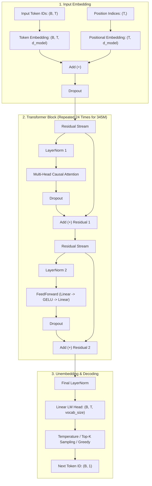
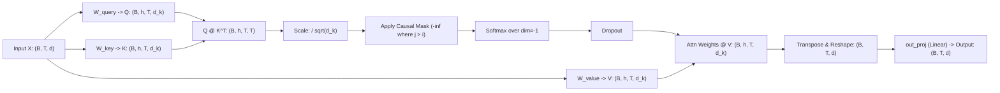

# 🏛️ GPT-2 Architecture Specification & Deep Dive

This document provides a comprehensive technical breakdown of the GPT-2 (Generative Pre-trained Transformer 2) architecture implemented in this repository, with a focus on the **345M (Medium)** model configuration while comparing it with the **124M (Small)** variant.

---

## 1. High-Level Paradigm: Causal Decoder-Only Transformer

GPT-2 is an **autoregressive, causal decoder-only transformer**. 

```
Input Tokens ──► Token & Pos Embeddings ──► [Transformer Block] × N ──► Final LayerNorm ──► Linear Head ──► Logits
```

Unlike the original Transformer ([Vaswani et al., 2017](https://arxiv.org/abs/1706.03762)) which featured an Encoder-Decoder structure for machine translation, GPT-2 discards the encoder entirely:
* **Autoregressive property:** The prediction of the next token at time step $t$ depends strictly on the tokens generated at time steps $1, \dots, t-1$.
* **Causal masking:** During training and batch inference, an upper-triangular mask sets future attention affinities to $-\infty$, ensuring no token can "look ahead" into future positions.
* **Pre-LayerNorm architecture:** Layer normalization is applied at the **input** of each sub-block (attention and MLP) rather than at the output (Post-LN), dramatically improving training stability and gradient flow across deep networks.

---

## 2. Configuration & Parameter Breakdown

The codebase supports standard OpenAI GPT-2 model specifications:

| Parameter | GPT-2 Small (124M) | GPT-2 Medium (345M - Active) | GPT-2 Large (774M) | GPT-2 XL (1558M) |
| :--- | :---: | :---: | :---: | :---: |
| **Vocabulary Size ($V$)** | 50,257 | **50,257** | 50,257 | 50,257 |
| **Context Length ($T_{max}$)** | 1,024 | **1,024** | 1,024 | 1,024 |
| **Embedding Dimension ($d_{model}$)** | 768 | **1,024** | 1,280 | 1,600 |
| **Attention Heads ($h$)** | 12 | **16** | 20 | 25 |
| **Head Dimension ($d_{head} = d / h$)** | 64 | **64** | 64 | 64 |
| **Transformer Layers ($N$)** | 12 | **24** | 36 | 48 |
| **QKV Bias** | True | **True** | True | True |
| **Total Parameters** | ~124,439,808 | **~354,823,168** | ~774,030,080 | ~1,557,611,200 |

### Mathematical Parameter Calculation for 345M:
* **Token Embeddings (`tok_emb`):** $V \times d_{model} = 50,257 \times 1,024 = \mathbf{51,463,168}$
* **Positional Embeddings (`pos_emb`):** $T_{max} \times d_{model} = 1,024 \times 1,024 = \mathbf{1,048,576}$
* **Per Transformer Block ($N = 24$):**
  * Multi-Head Attention:
    * $W_Q, W_K, W_V$ weights + biases: $3 \times (d_{model} \times d_{model} + d_{model}) = 3 \times (1,024 \times 1,024 + 1,024) = 3,148,800$
    * $W_O$ (Out projection) weight + bias: $d_{model} \times d_{model} + d_{model} = 1,049,600$
    * Total Attention: $4,198,400$
  * Feed-Forward Network (MLP):
    * Linear 1 (Expansion $1024 \to 4096$): $1,024 \times 4,096 + 4,096 = 4,198,400$
    * Linear 2 (Contraction $4096 \to 1024$): $4,096 \times 1,024 + 1,024 = 4,195,328$
    * Total MLP: $8,393,728$
  * Layer Normalizations (`norm1`, `norm2`): $2 \times (2 \times d_{model}) = 4,096$
  * Single Block Total: $\approx 12,596,224$ params
  * Total for 24 Blocks: $24 \times 12,596,224 = \mathbf{302,309,376}$
* **Final LayerNorm:** $2 \times d_{model} = \mathbf{2,048}$
* **Output Head (`out_head`):** $d_{model} \times V = 1,024 \times 50,257 = \mathbf{51,463,168}$ *(Note: In weight-tied models, this shares storage with `tok_emb`)*.

---

## 3. Structural Flowchart



---

## 4. Detailed Component Walkthrough

### 4.1 Tokenization & Positional Encoding
* **Byte-Pair Encoding (BPE):** Text is tokenized into subwords using OpenAI's `tiktoken` (`gpt2` encoding), supporting a vocabulary of 50,257 tokens (including `<|endoftext|>`).
* **Embeddings:**
  $$\mathbf{X}_0 = \text{Embedding}_{tok}(\text{in\_idx}) + \text{Embedding}_{pos}(\mathbf{p})$$
  where $\mathbf{p} = [0, 1, 2, \dots, T-1]$. Unlike modern models using Rotary Position Embeddings (RoPE), GPT-2 uses **learned absolute positional embeddings** with a hard context limit of 1,024 tokens.

---

### 4.2 Pre-Layer Normalization
Applied prior to multi-head attention and the feed-forward network:
$$\text{LayerNorm}(\mathbf{x}) = \frac{\mathbf{x} - \mu}{\sqrt{\sigma^2 + \epsilon}} \odot \boldsymbol{\gamma} + \boldsymbol{\beta}$$
* $\mu, \sigma^2$: Mean and variance calculated across the feature dimension $d_{model}$ for each token independently.
* $\boldsymbol{\gamma}$ (`scale`), $\boldsymbol{\beta}$ (`shift`): Learnable affine parameters.
* $\epsilon = 10^{-5}$: Numerical stabilization factor.

---

### 4.3 Multi-Head Causal Self-Attention



#### Attention Steps:
1. **Projection:** Input $\mathbf{X} \in \mathbb{R}^{B \times T \times d_{model}}$ is projected into Query ($\mathbf{Q}$), Key ($\mathbf{K}$), and Value ($\mathbf{V}$) matrices:
   $$\mathbf{Q} = \mathbf{X} \mathbf{W}_Q + \mathbf{b}_Q, \quad \mathbf{K} = \mathbf{X} \mathbf{W}_K + \mathbf{b}_K, \quad \mathbf{V} = \mathbf{X} \mathbf{W}_V + \mathbf{b}_V$$
2. **Multi-Head Reshape:** Each tensor of shape $(B, T, d_{model})$ is split into $h = 16$ heads, each with dimension $d_{head} = 64$:
   $$\mathbf{Q}, \mathbf{K}, \mathbf{V} \in \mathbb{R}^{B \times h \times T \times d_{head}}$$
3. **Scaled Dot-Product:**
   $$\mathbf{S} = \frac{\mathbf{Q} \mathbf{K}^T}{\sqrt{d_{head}}}$$
4. **Causal Masking:**
   $$\mathbf{S}_{b, h, i, j} = \begin{cases} \mathbf{S}_{b, h, i, j} & \text{if } j \le i \\ -\infty & \text{if } j > i \end{cases}$$
   *This ensures $\text{softmax}(-\infty) = 0$, completely preventing position $i$ from attending to future tokens $j > i$.*
5. **Attention Weights & Aggregation:**
   $$\mathbf{A} = \text{Dropout}(\text{Softmax}(\mathbf{S}, \text{dim}=-1))$$
   $$\mathbf{O}_{heads} = \mathbf{A} \mathbf{V} \in \mathbb{R}^{B \times h \times T \times d_{head}}$$
6. **Output Combination:** Heads are concatenated back to $(B, T, d_{model})$ and projected linearly:
   $$\text{Context} = \mathbf{O}_{heads} \mathbf{W}_O + \mathbf{b}_O$$

---

### 4.4 Feed-Forward Network (FFN / MLP)
The position-wise feed-forward network consists of two linear transformations with an intermediate activation function:
$$\text{FFN}(\mathbf{x}) = \text{GELU}(\mathbf{x} \mathbf{W}_1 + \mathbf{b}_1) \mathbf{W}_2 + \mathbf{b}_2$$
* **Expansion:** Projects from $d_{model} = 1024 \to 4 \times 1024 = 4096$.
* **Activation:** **Gaussian Error Linear Unit (GELU)**:
  $$\text{GELU}(x) = x \cdot \Phi(x) = 0.5 x \left(1 + \text{tanh}\left(\sqrt{\frac{2}{\pi}} \left(x + 0.044715 x^3\right)\right)\right)$$
  *GELU introduces smooth probabilistic non-linearity, outperforming ReLU in transformer models.*
* **Contraction:** Projects back from $4096 \to 1024$.

---

### 4.5 Residual Connections
Each sub-layer is wrapped in a residual connection:
$$\mathbf{X}_{mid} = \mathbf{X} + \text{Dropout}(\text{Attention}(\text{LayerNorm}_1(\mathbf{X})))$$
$$\mathbf{X}_{out} = \mathbf{X}_{mid} + \text{Dropout}(\text{FFN}(\text{LayerNorm}_2(\mathbf{X}_{mid})))$$
Residual connections provide unimpeded gradient highways from the output layers directly back to early layers, preventing the vanishing gradient problem across 24 layers.

---

### 4.6 Unembedding & Decoding
1. **Final Normalization:** After the 24th block, representations pass through a final LayerNorm:
   $$\mathbf{H}_{final} = \text{LayerNorm}_{final}(\mathbf{X}_{24}) \in \mathbb{R}^{B \times T \times 1024}$$
2. **Logits Projection:**
   $$\mathbf{Z} = \mathbf{H}_{final} \mathbf{W}_{head} \in \mathbb{R}^{B \times T \times 50,257}$$
3. **Sampling Strategy (`generate`):**
   * **Last Logits Selection:** Extract $\mathbf{z}_{last} = \mathbf{Z}[:, -1, :]$.
   * **Top-K Filtering:** Restrict choices to the top $K$ highest-probability tokens by masking values below the $K$-th logit to $-\infty$.
   * **Temperature Scaling:** Scale logits by temperature $T$: $\mathbf{z}' = \mathbf{z} / T$.
   * **Multinomial Sampling:** Convert to probabilities via Softmax and draw the next token:
     $$\mathbf{y}_{next} \sim \text{Categorical}(\text{Softmax}(\mathbf{z}'))$$

---

## 5. Summary of Key Architectural Fixes in this Codebase

1. **Causal Masking Reassignment:**
   * *Before:* `attn_scores.masked_fill(...)` (discarded returned tensor; future positions were unmasked).
   * *After:* `attn_scores = attn_scores.masked_fill(mask_bool, -torch.inf)` (guarantees true causal language modeling).
2. **Proper 345M Scaling:**
   * Separated `GPT_CONFIG_124M` and `GPT_CONFIG_345M`.
   * Loaded OpenAI's 345M checkpoint with $d_{model}=1024$, $h=16$, and $N=24$.
3. **Vectorized Top-K Broadcasting:**
   * Replaced `top_logits[:, -1]` with `top_logits[:, -1:]` ensuring seamless multi-batch $(B > 1)$ text generation without dimension broadcasting exceptions.
4. **Hardware Acceleration for Apple Silicon:**
   * Native device resolution dynamically selects **MPS** (`torch.device("mps")`) on Apple Silicon Macs (such as the M-series with 24GB Unified Memory) for high-performance GPU tensor operations.
